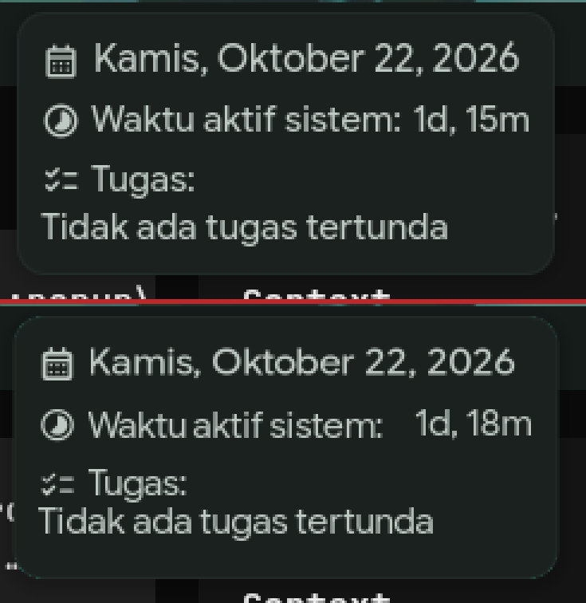
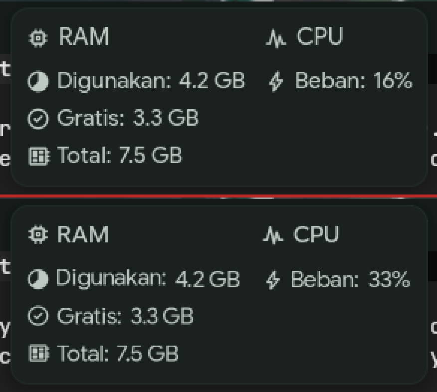
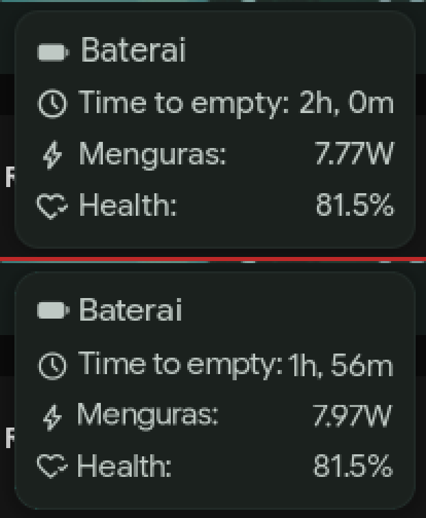

# cbar — replika bar dots-hyprland di C + cairo/pango

Prototipe bar Wayland standalone untuk mengukur berapa biaya sebenarnya dari
bar Quickshell. Tujuannya bukan mengganti seluruh shell: sidebar, overview,
media controls, brightness, dan panel lain tetap dilayani Quickshell lewat IPC.
Yang diganti hanya permukaan bar (dan interaksinya).

Status: **eksperimen, tidak diaktifkan otomatis**. Shell harian tetap memakai
konfigurasi Quickshell dengan lazy panels (`docs/MEMORY.md`).


*(atas: bar Quickshell asli, bawah: cbar. Nilai live seperti CPU, jam, dan
baterai tentu berbeda antar pengambilan gambar.)*

## Yang sudah diparitas

- Geometri dan palet bar 1366×768: grup kiri `184..544`, workspace
  `548..818`, jam `822..1182`, pil baterai `1147..1177`, pil kanan
  `1236..1343` (107 px saat bell tampil, 73 px saat disembunyikan).
- Latar translucent + backdrop blur Hyprland, termasuk `ignorealpha 0.79`.
- Font Google Sans Flex (Pango `opsz=100`) dan Material Symbols Rounded.
- Ikon aplikasi WhiteSur-dark yang diwarnai dengan rumus Colorize Qt.
- Data live: Hyprland IPC, `/proc`, `/sys`, UPower (`busctl`), `playerctl`.
- Klik, scroll, hover, dan tooltip/popup (lihat tabel di bawah).
- Bell notifikasi dinamis, termasuk state bridge Quickshell: titik unread 8×8,
  ikon `notifications_paused` saat silent/DND, badge angka saat
  `showUnreadCount=true`, serta lebar pil 107 ↔ 73 px.
- Todo asli dari `todo.json`: maksimal 5 tugas belum selesai, baris overflow
  `... dan N lainnya`, dukungan konten multiline, dan tinggi popup dinamis.
- Visibilitas resource dibaca dari `~/.config/illogical-impulse/config.json`:
  `showMemory`, `showCpu`, `showSwap`, `alwaysShowCpu`, dan `alwaysShowSwap`.
  Swap memakai `/proc/meminfo` (`SwapTotal`/`SwapFree`) dan badge CPU mengikuti
  aturan media Quickshell. Polling RAM/CPU juga berhenti saat indikatornya
  dimatikan, sama seperti `ResourceUsage.qml`.
- Ambang warna error resource (`memoryWarningThreshold`,
  `cpuWarningThreshold`, `swapWarningThreshold`) dan `battery.low` dibaca dari
  config yang sama; baterai low berubah merah saat tidak sedang di-charge.
- Ukuran kartu popup mengikuti isi (lebar RAM/Swap/CPU, uptime, todo, dan baris
  baterai yang sedang terlihat), bukan angka hasil ukur yang di-hardcode.

## Build

```sh
make            # menghasilkan ./cproto
make scroll     # opsional: helper uinput untuk tes scroll
```

Dependensi build: `gcc`/`cc`, `pkg-config`, `wayland-client`, `cairo`,
`pangocairo`. Font dan ikon diasumsikan sudah terpasang seperti di dotfiles ini.

## Menjalankan

Tutup bar Quickshell dulu supaya cbar menempati `y=0` (kalau bar asli masih
terbuka, exclusive zone membuat cbar berada di `y=40`):

```sh
qs -c ii ipc call bar close
```

Tambahkan layer rule blur ke sesi Hyprland yang sedang berjalan:

```sh
hyprctl eval 'hl.layer_rule({ match = { namespace = "cproto" }, blur = true })'
hyprctl eval 'hl.layer_rule({ match = { namespace = "cproto" }, ignore_alpha = 0.79 })'
```

Jalankan dari direktori ini (aset PNG dibaca relatif terhadap cwd):

```sh
./cproto
```

Untuk mengambil screenshot popup tanpa menggerakkan pointer (mis. saat
membandingkan geometri), popup bisa dipaksa lewat env: `1` jam, `2` resource,
`3` baterai.

```sh
CPROTO_FORCE_POPUP=2 ./cproto
```

Kembali ke bar asli:

```sh
pkill -x cproto
qs -c ii ipc call bar open
```

Layer rule hanya berlaku untuk namespace `cproto`; tidak mengganggu bar asli.
Kalau Hyprland di-reload, rule perlu ditambahkan lagi.

## Peta interaksi

| Area | Aksi |
| --- | --- |
| `x < 184` (tombol kiri + jendela aktif) | klik kiri: `sidebarLeft toggle` |
| `x < 184` | scroll: brightness naik/turun (`brightness increment/decrement`) |
| Workspace `548..818` | klik kiri: fokus workspace; klik kanan: overview (`search workspacesToggle`); back/side: special workspace |
| Workspace `548..818` | scroll atas/bawah: workspace relatif `r-1`/`r+1` |
| Media `media_x+5..539` (default `303..539`) | kiri: buka `mediaControls`; tengah: play/pause; kanan/forward: next; back: previous |
| Resource `184..184+resources_w+9` (default `184..303`) | hover: popup RAM/Swap/CPU; tidak ada aksi klik |
| Jam `905..1050` | hover: popup jam; klik: `sidebarRight toggle` |
| Baterai `1140..1182` | hover: popup baterai; klik: `sidebarRight toggle` |
| Kanan `x >= 1182` | klik kiri: `sidebarRight toggle`; scroll: volume `2%+`/`2%-` |

Popup hanya digambar selama pointer berada di bar (0..40 px); area di bawah bar
tetap click-through.

## Popup

Tiga kartu mengikuti geometri Quickshell yang diukur langsung. Posisi kartu
mengikuti pusat target hover, sedangkan lebar/tinggi dihitung dari isi. Khusus
resource, pusat kartu ikut bergeser saat indikator RAM/Swap/CPU berubah:

| Popup | Pusat `x` | Lebar | Tinggi |
| --- | --- | --- | --- |
| Jam | 989.5 | `max(header, uptime, label todo, todo) + 20`; mis. 225 px kosong, 470 px untuk 6 baris todo | `110 + 19 × (baris todo - 1)` |
| Resource | `254.5 + (resources_w − 110) / 2` | `ram_w [+ 12 + swap_w] [+ 12 + cpu_w] + 22` untuk kolom yang terlihat; mis. 279 px | 120 px jika RAM/Swap tampil; 70 px jika hanya CPU |
| Baterai | 1172.5 | `max(baris terlihat) + 16`; mis. 195 px | 116 px; −24.5 px per baris waktu/daya yang disembunyikan |

`resources_w` adalah lebar area resource di bar (default 110 px untuk RAM+CPU).
Konten dimulai di `kartu.x + 10` dan berakhir di `kartu.x + lebar − 10`.
Contoh ukur: jam `877,50 225×110` (tanpa todo), resource RAM+CPU
`115,50 279×120` (pusat 254.5), RAM saja `143,50 169×120` (227.5), CPU saja
`171,50 120×70` (231), dan RAM+Swap+CPU `62,50 438×120` (281.5). Angka ini
berubah mengikuti uptime, nilai baterai, isi todo, dan indikator yang aktif —
jangan menggantinya dengan konstanta.

Warna kartu diambil dari render asli: latar `(27,33,30)`, border
`(33,42,39)`, bayangan bertingkat, radius 12, padding 10. Data baterai
memakai UPower (`TimeToEmpty`, `EnergyRate`, `Capacity`, `State`) supaya
nilainya sama dengan service `Battery.qml`; RAM memakai `MemAvailable`
seperti `ResourceUsage.qml`.

Perbandingan (atas: Quickshell asli, bawah: cbar; nilai live seperti uptime,
CPU, dan waktu baterai berbeda antar pengambilan):

| Jam | Resource | Baterai |
| --- | --- | --- |
|  |  |  |

## Memori

Diukur dengan `/proc/<pid>/smaps_rollup` setelah popup, bell, dan todo
ditambahkan (permukaan 1366×320; permukaan diperbesar agar popup todo enam
baris tidak terpotong):

| Metrik | Nilai |
| --- | ---: |
| PSS | **11,5 MB** |
| RSS | 32,2 MB |
| Anonymous | 6,9 MB |
| Private dirty | 6,9 MB |

Versi visual-only (permukaan 63 px, tanpa popup/bell) sebelumnya: PSS 9,1 MB,
RSS 29,0 MB, anon 5,2 MB. Kenaikan ~2,4 MB berasal dari buffer 320 px, data
popup/todo, dan pembacaan config resource.

Angka ini **bukan** pengganti angka shell: Quickshell utuh (semua panel)
~344–355 MB PSS, dan biaya marginal panel bar di dalam Quickshell ~67 MB.
cbar hanya menggantikan permukaan bar; base Qt/Quickshell tetap ada karena
sidebar dan panel lain masih dipakai.

## Batasan yang diketahui

- **Bell notifikasi** membutuhkan state bridge di
  `~/.cache/quickshell/notifications/state.json` (tiga baris: `unread`,
  `silent`, `showUnreadCount`). Bridge ini ditulis oleh salinan
  `services/Notifications.qml` di repo ini; tanpa bridge, cbar jatuh ke
  heuristik mtime `notifications.json` dan tidak bisa membedakan silent/DND
  atau badge angka. Salinan live di `~/.config/quickshell/ii` harus disinkronkan
  manual.
- **Todo** dimuat dari `~/.local/state/quickshell/user/todo.json`; cbar
  memantau mtime dan ukuran file, bukan perubahan isi Quickshell secara
  langsung. Tugas `done` difilter, maksimal 5 tugas ditampilkan, dan baris
  overflow mengikuti `ClockWidgetPopup.qml`.
- **Config resource** dibaca ulang sekitar satu detik setelah file berubah.
  Yang dipetakan baru `showMemory`, `showCpu`, `showSwap`, `alwaysShowCpu`,
  `alwaysShowSwap`, tiga ambang warning, dan `battery.low`. Mode bar
  singkat (`useShortenedForm`) dan `alwaysShowAllResources` belum dimodelkan;
  cbar mengasumsikan bar penuh seperti konfigurasi saat ini.
- Popup tidak interaktif (kartu aslinya juga hanya menampilkan data).
- Persentase CPU bisa berbeda beberapa persen dari Quickshell karena waktu
  sampling `/proc/stat` tidak disinkronkan; RAM, baterai, jam, dan uptime
  memakai sumber yang sama.
- Metrik teks Pango vs Qt bisa membuat lebar kartu/pil berbeda beberapa
  piksel; pusat kartu, tinggi, dan posisi relatif tetap dipertahankan.
- Tray menu, banner notifikasi, sidebar, overview, dan panel lain tetap milik
  Quickshell. cbar memanggil target IPC `qs -c ii`.
- Prototipe dikalibrasi untuk 1366×768 skala 1 dan konfigurasi bar saat ini.
  Untuk resolusi lain, konstanta geometri di `bar.c` perlu disesuaikan.
- Label popup ditulis dalam bahasa Indonesia, mengikuti locale mesin ini.

## Tes scroll

`scroll.c` membuat virtual mouse lewat `/dev/uinput`, mengirim satu notifikasi
wheel, lalu menghapus device. Butuh akses tulis ke `/dev/uinput` (biasanya
grup `input`).

```sh
make scroll
hyprctl dispatch 'hl.dsp.cursor.move({x=1355, y=20})'
./scroll 1     # volume +2%
./scroll -1    # volume -2%
```

Sudah diverifikasi di sesi ini:

- volume `0,48 → 0,50 → 0,48`
- brightness `1875 → 1500 → 1875`
- workspace `1 ↔ 2` (scroll atas = sebelumnya, bawah = berikutnya)

## File

| File | Isi |
| --- | --- |
| `bar.c` | seluruh prototipe (Wayland, layer shell, gambar, input, popup) |
| `wlr-layer-shell-*`, `xdg-shell-*` | protokol yang sudah digenerate |
| `kitty.png`, `brave.png`, `dolphin.png`, `spark_icon.png` | aset ikon WhiteSur-dark |
| `scroll.c` | helper tes wheel via uinput (bukan bagian dari cbar) |
| `preview.png` | perbandingan bar asli (atas) vs cbar (bawah) |
