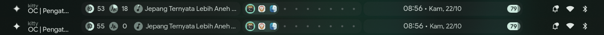

# cbar — replika bar dots-hyprland di C + cairo/pango

Prototipe bar Wayland standalone untuk mengukur berapa biaya sebenarnya dari
bar Quickshell. Tujuannya bukan mengganti seluruh shell: sidebar, overview,
media controls, brightness, dan panel lain tetap dilayani Quickshell lewat IPC.
Yang diganti hanya permukaan bar (dan interaksinya).

Status: **eksperimen, tidak diaktifkan otomatis**. Shell harian tetap memakai
konfigurasi Quickshell dengan lazy panels (`docs/MEMORY.md`).



*(atas: bar Quickshell asli, bawah: cbar. Nilai live seperti CPU, jam, dan
baterai tentu berbeda antar pengambilan gambar.)*

## Yang sudah diparitas

- Geometri dan palet bar 1366×768: grup kiri `184..544`, workspace
  `548..818`, jam `822..1182`, pil baterai `1147..1177`, pil kanan
  `1236..1343` (107 px saat bell tampil, 73 px saat disembunyikan).
- Latar translucent + backdrop blur Hyprland, termasuk `ignorealpha 0.79`.
- Font Google Sans Flex (Pango `opsz=100`) dan Material Symbols Rounded.
- Ikon aplikasi WhiteSur-dark yang diwarnai dengan rumus Colorize Qt.
- Data live: Hyprland IPC, `/proc`, `/sys`, UPower (`busctl`), `playerctl`.
- Klik, scroll, hover, dan tooltip/popup (lihat tabel di bawah).
- Bell notifikasi dinamis: muncul saat ada notifikasi baru, hilang saat sidebar
  kanan dibuka. Lebar pil ikut berubah 107 ↔ 73 px.

## Build

```sh
make            # menghasilkan ./cproto
make scroll     # opsional: helper uinput untuk tes scroll
```

Dependensi build: `gcc`/`cc`, `pkg-config`, `wayland-client`, `cairo`,
`pangocairo`. Font dan ikon diasumsikan sudah terpasang seperti di dotfiles ini.

## Menjalankan

Tutup bar Quickshell dulu supaya cbar menempati `y=0` (kalau bar asli masih
terbuka, exclusive zone membuat cbar berada di `y=40`):

```sh
qs -c ii ipc call bar close
```

Tambahkan layer rule blur ke sesi Hyprland yang sedang berjalan:

```sh
hyprctl eval 'hl.layer_rule({ match = { namespace = "cproto" }, blur = true })'
hyprctl eval 'hl.layer_rule({ match = { namespace = "cproto" }, ignore_alpha = 0.79 })'
```

Jalankan dari direktori ini (aset PNG dibaca relatif terhadap cwd):

```sh
./cproto
```

Kembali ke bar asli:

```sh
pkill -x cproto
qs -c ii ipc call bar open
```

Layer rule hanya berlaku untuk namespace `cproto`; tidak mengganggu bar asli.
Kalau Hyprland di-reload, rule perlu ditambahkan lagi.

## Peta interaksi

| Area | Aksi |
| --- | --- |
| `x < 184` (tombol kiri + jendela aktif) | klik kiri: `sidebarLeft toggle` |
| `x < 184` | scroll: brightness naik/turun (`brightness increment/decrement`) |
| Workspace `548..818` | klik kiri: fokus workspace; klik kanan: overview (`search workspacesToggle`); back/side: special workspace |
| Workspace `548..818` | scroll atas/bawah: workspace relatif `r-1`/`r+1` |
| Media `303..539` | kiri: buka `mediaControls`; tengah: play/pause; kanan/forward: next; back: previous |
| Resource `184..303` | hover: popup RAM/CPU; tidak ada aksi klik |
| Jam `905..1050` | hover: popup jam; klik: `sidebarRight toggle` |
| Baterai `1140..1182` | hover: popup baterai; klik: `sidebarRight toggle` |
| Kanan `x >= 1182` | klik kiri: `sidebarRight toggle`; scroll: volume `2%+`/`2%-` |

Popup hanya digambar selama pointer berada di bar (0..40 px); area di bawah bar
tetap click-through.

## Popup

Tiga kartu mengikuti geometri Quickshell yang diukur langsung:

| Popup | Kartu | Isi |
| --- | --- | --- |
| Jam | `875,50 229×110` | tanggal panjang, uptime, todo (`Tidak ada tugas tertunda`) |
| Resource | `117,50 275×120` | RAM terpakai/gratis/total + beban CPU |
| Baterai | `1075,50 194×116` | time-to-empty/full, daya, health |

Warna kartu diambil dari render asli: latar `(27,33,30)`, border
`(33,42,39)`, bayangan bertingkat, radius 12, padding 10. Data baterai
memakai UPower (`TimeToEmpty`, `EnergyRate`, `Capacity`, `State`) supaya
nilainya sama dengan service `Battery.qml`; RAM memakai `MemAvailable`
seperti `ResourceUsage.qml`.

## Memori

Diukur dengan `/proc/<pid>/smaps_rollup` setelah popup dan bell ditambahkan
(permukaan 1366×200):

| Metrik | Nilai |
| --- | ---: |
| PSS | **11,3 MB** |
| RSS | 31,6 MB |
| Anonymous | 6,5 MB |
| Private dirty | 6,6 MB |

Versi visual-only (permukaan 63 px, tanpa popup/bell) sebelumnya: PSS 9,1 MB,
RSS 29,0 MB, anon 5,2 MB. Kenaikan ~2 MB berasal dari buffer 200 px dan data
popup.

Angka ini **bukan** pengganti angka shell: Quickshell utuh (semua panel)
~344–355 MB PSS, dan biaya marginal panel bar di dalam Quickshell ~67 MB.
cbar hanya menggantikan permukaan bar; base Qt/Quickshell tetap ada karena
sidebar dan panel lain masih dipakai.

## Batasan yang diketahui

- **Bell notifikasi**: Quickshell menyimpan `Notifications.unread` dan
  `Notifications.silent` di memori dan tidak mengeksposnya lewat IPC. cbar
  memakai mtime `~/.cache/quickshell/notifications/notifications.json`
  sebagai heuristik: file berubah → bell tampil; sidebar kanan dibuka → bell
  disembunyikan dan baseline diperbarui. Mode *silent/DND* tidak terdeteksi,
  dan badge angka unread tidak digambar (hanya titik).
- Todo di popup jam masih hardcoded `Tidak ada tugas tertunda`; `todo.json`
  belum diparse.
- Lebar kartu popup saat ini fixed ke hasil ukur. Tinggi baterai menyesuaikan
  kalau baris time-to-empty disembunyikan, tetapi lebarnya belum ikut menyusut.
- Popup tidak interaktif (kartu aslinya juga hanya menampilkan data).
- Tray menu, banner notifikasi, sidebar, overview, dan panel lain tetap milik
  Quickshell. cbar memanggil target IPC `qs -c ii`.
- Prototipe dikalibrasi untuk 1366×768 skala 1 dan konfigurasi bar saat ini.
  Untuk resolusi lain, konstanta geometri di `bar.c` perlu disesuaikan.
- Label popup ditulis dalam bahasa Indonesia, mengikuti locale mesin ini.

## Tes scroll

`scroll.c` membuat virtual mouse lewat `/dev/uinput`, mengirim satu notifikasi
wheel, lalu menghapus device. Butuh akses tulis ke `/dev/uinput` (biasanya
grup `input`).

```sh
make scroll
hyprctl dispatch 'hl.dsp.cursor.move({x=1355, y=20})'
./scroll 1     # volume +2%
./scroll -1    # volume -2%
```

Sudah diverifikasi di sesi ini:

- volume `0,48 → 0,50 → 0,48`
- brightness `1875 → 1500 → 1875`
- workspace `1 ↔ 2` (scroll atas = sebelumnya, bawah = berikutnya)

## File

| File | Isi |
| --- | --- |
| `bar.c` | seluruh prototipe (Wayland, layer shell, gambar, input, popup) |
| `wlr-layer-shell-*`, `xdg-shell-*` | protokol yang sudah digenerate |
| `kitty.png`, `brave.png`, `dolphin.png`, `spark_icon.png` | aset ikon WhiteSur-dark |
| `scroll.c` | helper tes wheel via uinput (bukan bagian dari cbar) |
| `preview.png` | perbandingan bar asli (atas) vs cbar (bawah) |
